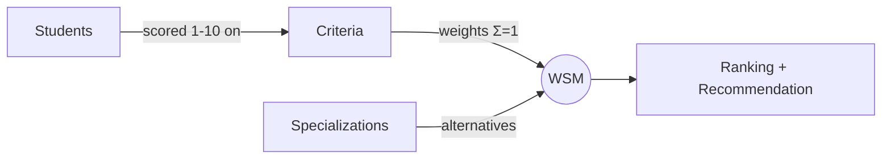
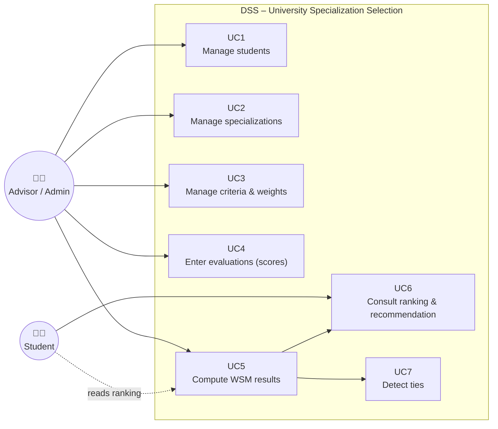
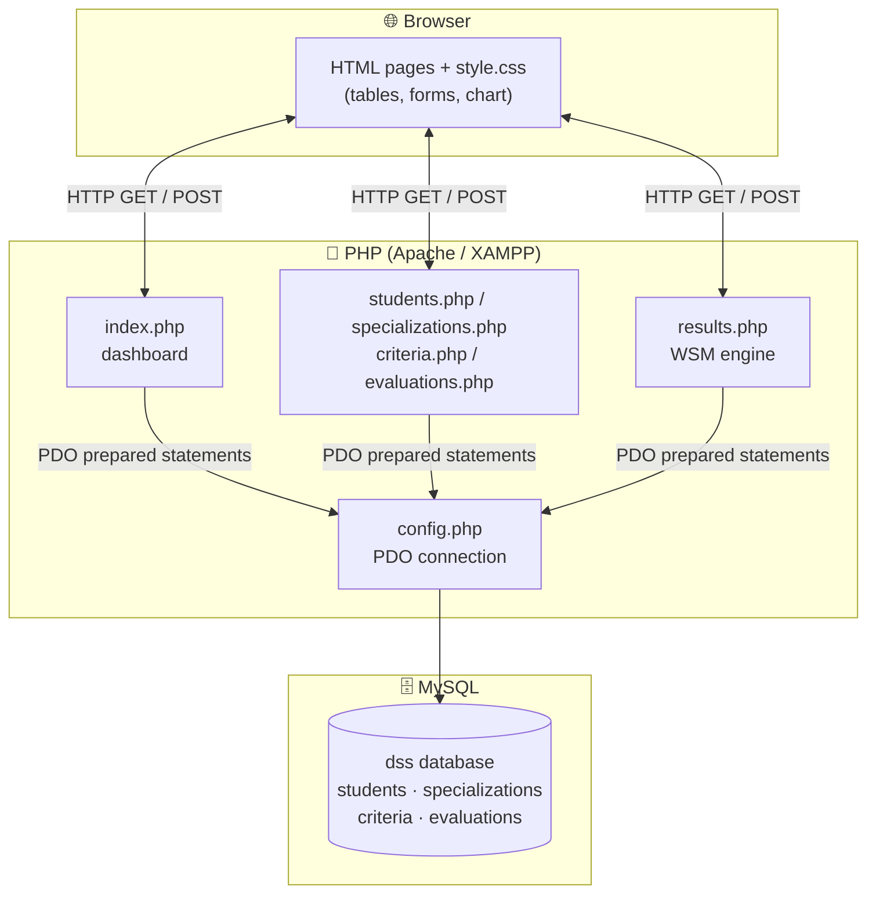
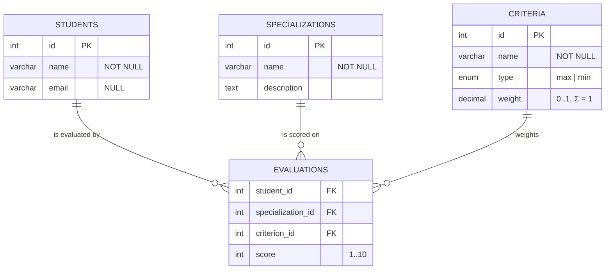
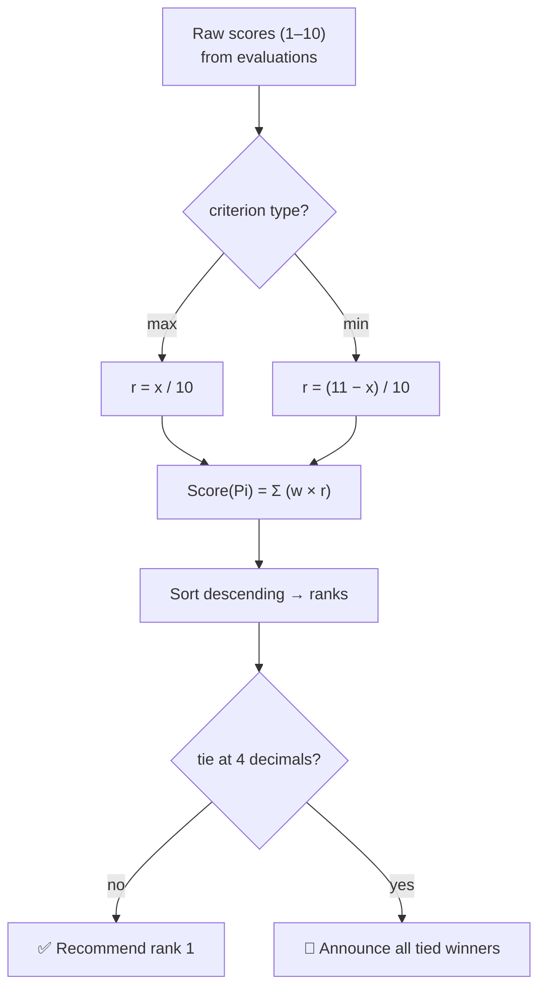
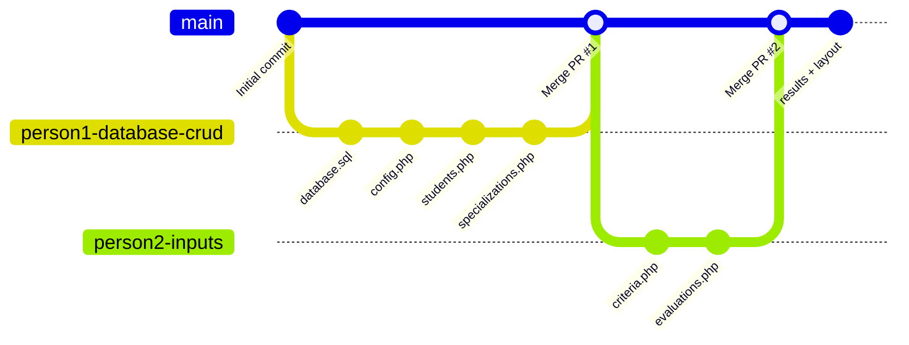

# DSS – University Specialization Selection


Web app (**PHP + MySQL**) that helps a student choose the university
specialization that best matches their profile, using the
**Weighted Sum Model (WSM)** — a classical Multi-Criteria Decision Making (MCDM) method.

---

## 📑 Table of contents
1. [How it works (short)](#-how-it-works-short)
2. [Actors](#-actors)
3. [Use cases](#-use-cases)
4. [Use case details](#-use-case-details)
5. [Architecture](#️-architecture)
6. [Database design (ER)](#-database-design-er)
7. [The WSM method](#-the-wsm-method)
8. [Worked example](#-worked-example)
9. [Run it (Windows, XAMPP)](#-run-it-windows-xampp)
10. [Files](#-files)
11. [Project workflow (Git)](#-project-workflow-git)

---

## 🧭 How it works (short)

1. The administrator defines **students**, **specializations** and **criteria**
   (each criterion is *maximized* or *minimized* and has a **weight**).
2. For one student, **evaluations** are entered: a score from **1 to 10**
   for every (specialization, criterion) pair.
3. The app normalizes the scores, applies the weights, sums them per
   specialization (**WSM score**), **ranks** the specializations and
   **recommends** the one with the highest score.
4. Ties (equal scores at 4 decimals) are detected and reported.



---

## 👥 Actors

| Actor | Role in the system |
|---|---|
| 🧑‍🎓 **Student** | Is described by the evaluations; consults the results and the recommendation. |
| 🧑‍🏫 **Advisor / Admin** | Creates and maintains students, specializations, criteria, weights and evaluations, then runs the calculation. |

---

## 🎯 Use cases



| ID | Use case | Actor | Purpose |
|----|----------|-------|---------|
| **UC1** | Manage students | Advisor | Add, edit, delete students (name, email). |
| **UC2** | Manage specializations | Advisor | Add, edit, delete the alternative specializations (name, description). |
| **UC3** | Manage criteria & weights | Advisor | Add, edit, delete criteria; set type (**max/min**) and **weight** (0–1, weights sum to 1). |
| **UC4** | Enter evaluations | Advisor | For a chosen student, fill a **score 1–10** for each (specialization, criterion) pair; saved with upsert, can delete all of a student. |
| **UC5** | Compute WSM results | System | Normalize scores, apply weights, sum per specialization, **rank**. |
| **UC6** | Consult ranking & recommendation | Student / Advisor | See the sorted table, the chart and the **recommended specialization**. |
| **UC7** | Detect ties | System | If the top score is shared (4 decimals), report **all** winners as a tie. |

---

## 📖 Use case details

### UC4 — Enter evaluations (most complex)
| | |
|---|---|
| **Actor** | Advisor |
| **Precondition** | At least one student, one specialization and one criterion exist. |
| **Main flow** | 1. Choose a student → 2. A grid shows every (specialization × criterion) cell → 3. Enter scores 1–10 (empty cells are skipped) → 4. Save. |
| **Postcondition** | `evaluations` rows created/updated (**upsert**). Missing pairs are allowed — they mark the specialization *incomplete*. |
| **Alternate flow** | *Delete all* removes every evaluation of the chosen student. |
| **Validation** | Scores are clamped to the 1–10 range; empty cells are ignored. |

### UC5 — Compute WSM results
| | |
|---|---|
| **Actor** | System (triggered from `results.php`) |
| **Precondition** | Evaluations exist for the selected student. |
| **Main flow** | 1. Load criteria + weights → 2. Load the student's evaluations → 3. Normalize each score → 4. `score(Sᵢ) = Σ (wⱼ × rᵢⱼ)` / Σw → 5. Sort descending → 6. Assign ranks. |
| **Alternate flow** | A specialization with **missing evaluations** is listed as *incomplete* and excluded from the ranking. |
| **Special rule** | Scores rounded to **4 decimals**; equal top scores ⇒ **tie** → several winners are announced. |

---

## 🏗️ Architecture

Classic **LAMP-style 3-tier** architecture:



- All SQL uses **prepared statements** (protection against SQL injection).
- All output goes through an escape helper (`e()`) — protection against XSS.
- Forms use **POST-Redirect-GET**, so refreshing a page never re-submits a form.

---

## 🗄️ Database design (ER)



`EVALUATIONS` is the **junction table** of the three entities:
one row = *"student S gave specialization P the score x on criterion C"*.
All foreign keys use **ON DELETE CASCADE**.

---

## 📐 The WSM method

**Step 1 — Normalization** (brings all scores to 0…1):

| Criterion type | Formula | Example (x = 7) |
|---|---|---|
| **maximize** (higher is better) | `r = x / 10` | `0.7` |
| **minimize** (lower is better) | `r = (11 − x) / 10` | `0.4` |

**Step 2 — Weighted sum** per specialization *i*:

```
Score(Pi) = Σj ( weight_j × r_ij )      with Σ weights = 1
```

**Step 3 — Ranking**: sort descending; the **highest score wins** and is the
**recommendation**. Equal scores at **4 decimals** ⇒ tie.



---

## 🔢 Worked example

Criteria: `Alignment (w=0.5, max)` · `Difficulty (w=0.3, min)` · `Interest (w=0.2, max)`

| Criterion | w | type | CS raw → r | IS raw → r |
|---|---|---|---|---|
| Alignment | 0.5 | max | 8 → **0.8** | 6 → **0.6** |
| Difficulty | 0.3 | min | 6 → **0.5** | 4 → **0.7** |
| Interest | 0.2 | max | 7 → **0.7** | 9 → **0.9** |

| Specialization | Calculation | Score | Rank |
|---|---|---|---|
| **Computer Science** | 0.5×0.8 + 0.3×0.5 + 0.2×0.7 | **0.69** | 🥇 **1 — recommended** |
| **Information Systems** | 0.5×0.6 + 0.3×0.7 + 0.2×0.9 | 0.69 | 🥇 1 — **tie!** |

Here both reach **0.6900** → the app detects the **tie** and announces both.

---

## ▶️ Run it (Windows, XAMPP)

1. Install XAMPP and start **Apache** and **MySQL** in the XAMPP Control Panel.
2. Copy this whole folder to `C:\xampp\htdocs\dss`.
3. Open http://localhost/phpmyadmin → tab **Import** → choose `database.sql` → **Go**.
4. Open http://localhost/dss/

> If your MySQL has a password, edit `config.php`.

---

## 📁 Files

| File | Role |
|---|---|
| `database.sql` | Tables + sample data |
| `config.php` | DB connection (PDO) |
| `students.php` | Student CRUD |
| `specializations.php` | Specialization CRUD |
| `criteria.php` | Criteria CRUD (type max/min + weight 0–1) |
| `evaluations.php` | Enter scores (1–10) per student |
| `results.php` | WSM calculation, ranking, chart, recommendation, tie detection |
| `index.php` | Dashboard: record counts + usage guide |
| `header.php` / `footer.php` / `style.css` | Layout |
| `report/` | Each team member's report |

---

## 🌿 Project workflow (Git)

Each member works on **their own branch**, opens a **Pull Request**, and the
team merges it into `main`.


